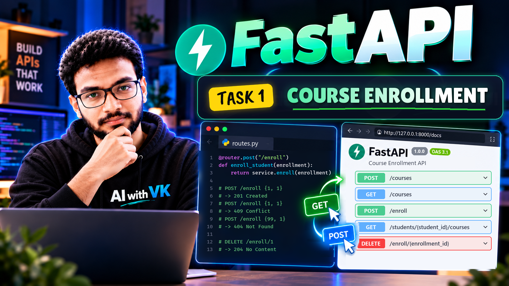
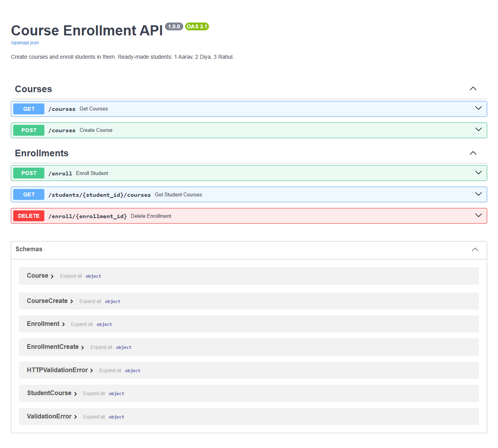
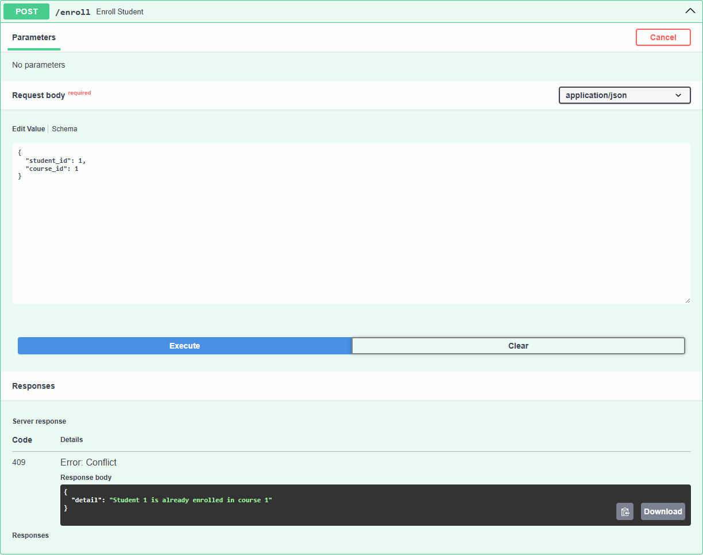
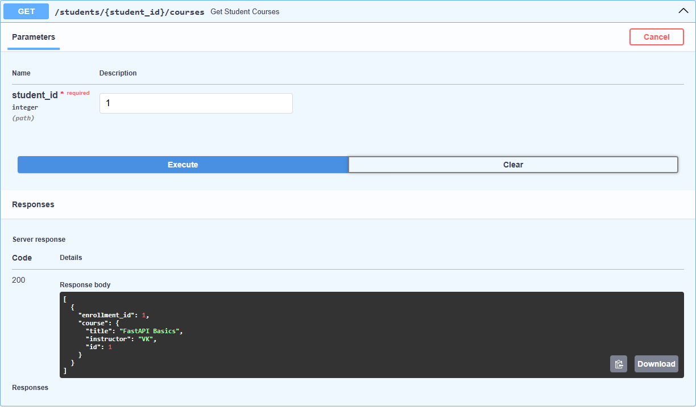

# Course Enrollment API

A small **FastAPI** application where students enroll in courses. It creates and
lists courses, enrolls a student, lists a student's courses and removes an enrollment.
A student cannot enroll in the same course twice. Every mistake gets a clear error:
a 404 when the student, course or enrollment does not exist, and a 409 for a duplicate.

Task 1 of the FastAPI module (05_api) in the 6 month FDE challenge.



---

## Table of contents

1. [Features](#features)
2. [Project structure](#project-structure)
3. [Modules, packages and OOP](#modules-packages-and-oop)
4. [How to run it](#how-to-run-it)
5. [Endpoints](#endpoints)
6. [Validation and error handling](#validation-and-error-handling)
7. [Using Swagger UI](#using-swagger-ui)
8. [Example requests and real responses](#example-requests-and-real-responses)
9. [Limitations](#limitations)

---

## Features

- `POST /courses` and `GET /courses` create and list courses.
- `POST /enroll` enrolls a student in a course.
- `GET /students/{student_id}/courses` lists every course a student is enrolled in,
  and gives each one's `enrollment_id` so you can delete it later.
- `DELETE /enroll/{enrollment_id}` removes one enrollment.
- **A student cannot enroll in the same course twice.** The second attempt returns `409 Conflict`.
- **A student, course or enrollment that doesn't exist returns `404 Not Found`** with a message naming the missing id.
- Bad input (a one-letter title, `student_id: 0`) is rejected by Pydantic with `422`.
- Interactive documentation at `/docs` (Swagger UI), generated from the code.

The task has no endpoint for creating students, so the app starts with three
ready-made students:

| student_id | name  |
|-----------:|-------|
| 1          | Aarav |
| 2          | Diya  |
| 3          | Rahul |

Courses and enrollments start empty. Create a course first, then enroll.

---

## Project structure

```
01_course_enrollment_api/
├── main.py              # creates the FastAPI app and plugs in the router
├── requirements.txt     # fastapi, uvicorn
├── README.md
├── course_enrollment.png            # video thumbnail
├── screenshots/                     # real Swagger UI screenshots
└── app/                 # the application package
    ├── __init__.py      # makes app/ a package
    ├── exceptions.py    # custom exception classes + the one handler that turns them into JSON
    ├── schemas.py       # Pydantic models: what goes in and out of the API
    ├── service.py       # EnrollmentService class: the data and the rules
    └── routes.py        # the five endpoints (APIRouter)
```

One request passes through the three modules in order:

```
HTTP request -> routes.py -> service.py -> schemas.py models -> JSON response
                (endpoint)   (rules + data)  (shape + validation)
```

`routes.py` only receives the request and returns the result. All the decisions,
such as "does this student exist?" and "is this a duplicate?", live in `service.py`.
When a rule fails, the service raises one of the exceptions from `exceptions.py`, and
the handler registered in `main.py` turns it into the JSON error response.

---

## Modules, packages and OOP

| Concept | Where it is used |
|---|---|
| **Package** | `app/` is a package (it has `__init__.py`). `main.py` imports from it: `from app.routes import router`. |
| **Modules** | Each file has one job: `schemas.py` (data shapes), `service.py` (rules), `routes.py` (HTTP). |
| **Class and object** | `EnrollmentService` is a class. `routes.py` creates one object of it, `service = EnrollmentService()`, and every endpoint shares that object. |
| **Encapsulation** | The dictionaries `courses`, `students` and `enrollments` live inside the object. Routes never touch them directly; they call methods like `service.enroll(...)`. |
| **Private helper methods** | `_get_student()` and `_get_course()` begin with `_`, meaning "for use inside the class". They raise the 404 errors, so every method checks ids the same way. |
| **Inheritance** | `Course(CourseCreate)` inherits `title` and `instructor` and adds `id`. `Enrollment(EnrollmentCreate)` does the same. The client sends the parent model; the API returns the child. |
| **Constructor** | `__init__` sets up empty storage, the id counters and the three ready-made students. |
| **Custom exception hierarchy** | `AppError(Exception)` is the parent; `NotFoundError` and `AlreadyEnrolledError` inherit from it. |
| **Overriding a class attribute** | Each exception subclass sets its own `status_code` (404, 409). The one handler reads `exc.status_code`, so it works for every subclass without an `if`. |
| **Custom validators** | `@field_validator` methods on `CourseCreate` clean and check `title` and `instructor`. |

---

## How to run it

Needs **Python 3.10 or newer**.

```bash
cd 05_api/01_course_enrollment_api

python -m venv venv
venv\Scripts\activate            # Windows
# source venv/bin/activate       # macOS / Linux

pip install -r requirements.txt
uvicorn main:app --reload
```

Then open:

- **Swagger UI:** http://127.0.0.1:8000/docs
- ReDoc: http://127.0.0.1:8000/redoc
- Raw OpenAPI schema: http://127.0.0.1:8000/openapi.json

---

## Endpoints

| Method | Path | Body | Success | Errors |
|---|---|---|---|---|
| POST | `/courses` | `{"title", "instructor"}` | **201** the new course | 422 |
| GET | `/courses` | - | **200** list of courses | - |
| POST | `/enroll` | `{"student_id", "course_id"}` | **201** the new enrollment | 404, 409, 422 |
| GET | `/students/{student_id}/courses` | - | **200** list of `{enrollment_id, course}` | 404 |
| DELETE | `/enroll/{enrollment_id}` | - | **204** no body | 404 |

---

## Validation and error handling

**Pydantic rules** (in [app/schemas.py](app/schemas.py)). FastAPI checks these before
our code runs and answers `422 Unprocessable Entity` when one fails:

| Field | Built-in rule (`Field`) | Custom rule (`@field_validator`) |
|---|---|---|
| `title` | 2 to 100 characters | must contain at least one letter; repeated spaces collapse to one |
| `instructor` | 2 to 50 characters | only letters, spaces and dots |
| `student_id`, `course_id` | whole number greater than 0 | - |

`model_config = ConfigDict(str_strip_whitespace=True)` strips spaces from both ends of
every text field **before** the rules run. So `"   "` counts as empty and fails the
2-character minimum, instead of slipping through as three characters.

### Custom validators

A `@field_validator` is a class method that receives the value after the built-in
checks. It either returns the value, possibly cleaned up, or raises `ValueError`.
Pydantic turns that `ValueError` into a normal 422 entry.

```python
@field_validator("title")
@classmethod
def title_has_letters(cls, value):
    if not re.search(r"[A-Za-z]", value):
        raise ValueError("title must contain at least one letter")
    return " ".join(value.split())          # "FastAPI    Basics" -> "FastAPI Basics"
```

| Sent | Result |
|---|---|
| `"title": "  FastAPI    Basics  ", "instructor": "  VK  "` | 201, saved as `"FastAPI Basics"` / `"VK"` |
| `"title": "12345"` | 422 `Value error, title must contain at least one letter` |
| `"instructor": "VK_99"` | 422 `Value error, instructor may contain only letters, spaces and dots` |
| `"title": "     "` | 422 `String should have at least 2 characters` (stripped to empty first) |

**Business rules** (in [app/service.py](app/service.py)):

| Situation | Status | `detail` message |
|---|---|---|
| Student id not in the list | 404 | `Student 99 not found` |
| Course id not created yet | 404 | `Course 99 not found` |
| Enrollment id not found (or already deleted) | 404 | `Enrollment 1 not found` |
| Same student + same course again | 409 | `Student 1 is already enrolled in course 1` |

The duplicate check loops over the existing enrollments and compares both ids:

```python
for e in self.enrollments.values():
    if e.student_id == data.student_id and e.course_id == data.course_id:
        raise AlreadyEnrolledError(f"Student {data.student_id} is already enrolled in course {data.course_id}")
```

### Custom exceptions

[app/exceptions.py](app/exceptions.py) defines a small family of exception classes:

```python
class AppError(Exception):              # parent of every error we raise on purpose
    status_code = 400
    def __init__(self, message):
        super().__init__(message)
        self.message = message

class NotFoundError(AppError):          # student / course / enrollment id missing
    status_code = 404

class AlreadyEnrolledError(AppError):   # same student + same course twice
    status_code = 409
```

`main.py` registers **one handler for the parent class**. It catches every
subclass and turns it into the same JSON shape FastAPI uses for its own errors:

```python
def app_error_handler(request, exc):
    return JSONResponse(status_code=exc.status_code, content={"detail": exc.message})

app.add_exception_handler(AppError, app_error_handler)
```

Why not raise FastAPI's `HTTPException` straight from the service?

- The service stays **plain Python**. It says *what* went wrong (`NotFoundError`),
  not *how* HTTP reports it. You could reuse `EnrollmentService` in a script or a
  CLI without importing FastAPI.
- The error type carries meaning. `except AlreadyEnrolledError:` is clearer than
  checking `status_code == 409`.
- Adding a new error is one short class. The handler never changes.

Why **409 Conflict** and not 400? The request is well formed. It clashes with
something that already exists, and 409 is the status code for exactly that.

The routes also list their error codes (`responses={404: ..., 409: ...}` in
[app/routes.py](app/routes.py)), so Swagger UI shows them next to each endpoint.

---

## Using Swagger UI

1. Start the server and open http://127.0.0.1:8000/docs.
2. **POST /courses**: click *Try it out*, send `{"title": "FastAPI Basics", "instructor": "VK"}` and click *Execute*. The response is `201` with `"id": 1`.
3. **POST /enroll**: send `{"student_id": 1, "course_id": 1}`. The response is `201` with `"id": 1` (the enrollment id).
4. Click *Execute* again with the same body. The response is now **409**.
5. **GET /students/{student_id}/courses** with `student_id = 1` shows the course and its `enrollment_id`.
6. **DELETE /enroll/{enrollment_id}** with `1` returns `204`. Deleting it a second time returns `404`.

**All five endpoints, grouped by tag:**



**Enrolling the same student in the same course twice returns 409:**



**A student's courses, each with its enrollment id:**



---

## Example requests and real responses

These were captured from the running app, in this order, on a fresh start. The
`curl` lines are for Git Bash, macOS or Linux; on Windows PowerShell use Swagger UI instead.

**Create a course: 201**
```bash
curl -X POST http://127.0.0.1:8000/courses -H "Content-Type: application/json" -d '{"title": "FastAPI Basics", "instructor": "VK"}'
```
```json
{ "title": "FastAPI Basics", "instructor": "VK", "id": 1 }
```
A second course, `"Python OOP"`, was created the same way and got `"id": 2`.

**Enroll student 1 in course 1: 201**
```bash
curl -X POST http://127.0.0.1:8000/enroll -H "Content-Type: application/json" -d '{"student_id": 1, "course_id": 1}'
```
```json
{ "student_id": 1, "course_id": 1, "id": 1 }
```
Student 1 was then enrolled in course 2 as well (enrollment id 2).

**Student 1's courses: 200**
```bash
curl http://127.0.0.1:8000/students/1/courses
```
```json
[
  { "enrollment_id": 1, "course": { "title": "FastAPI Basics", "instructor": "VK", "id": 1 } },
  { "enrollment_id": 2, "course": { "title": "Python OOP", "instructor": "VK", "id": 2 } }
]
```

**The same enrollment again: 409**
```json
{ "detail": "Student 1 is already enrolled in course 1" }
```

**A student that doesn't exist: 404** (`{"student_id": 99, "course_id": 1}`)
```json
{ "detail": "Student 99 not found" }
```

**A course that doesn't exist: 404** (`{"student_id": 1, "course_id": 99}`)
```json
{ "detail": "Course 99 not found" }
```

**Courses of a student that doesn't exist: 404** (`GET /students/99/courses`)
```json
{ "detail": "Student 99 not found" }
```

**A title that is too short: 422** (`{"title": "A", "instructor": "VK"}`)
```json
{
  "detail": [
    {
      "type": "string_too_short",
      "loc": ["body", "title"],
      "msg": "String should have at least 2 characters",
      "input": "A",
      "ctx": { "min_length": 2 }
    }
  ]
}
```

**Delete enrollment 1: 204**, then the same delete again: **404**
```bash
curl -X DELETE http://127.0.0.1:8000/enroll/1
```
```json
{ "detail": "Enrollment 1 not found" }
```

After the delete, `GET /students/1/courses` returns only the `Python OOP` course
(enrollment 2).

---

## Limitations

- Data is kept **in memory** (plain Python dictionaries), so it resets every time
  the server restarts. A database would be the next step.
- Students are fixed (ids 1 to 3), because the task lists no endpoint for creating them.
- There is no seat limit on courses, because the task did not ask for one.
