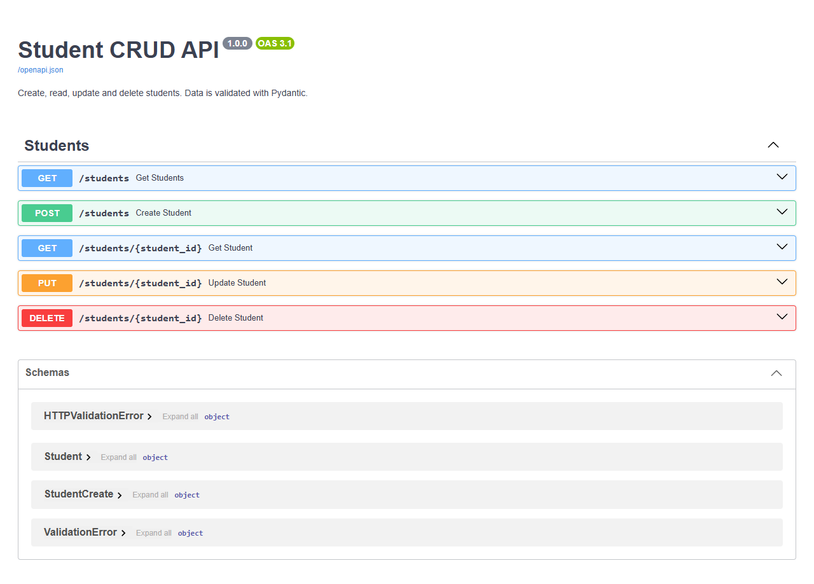
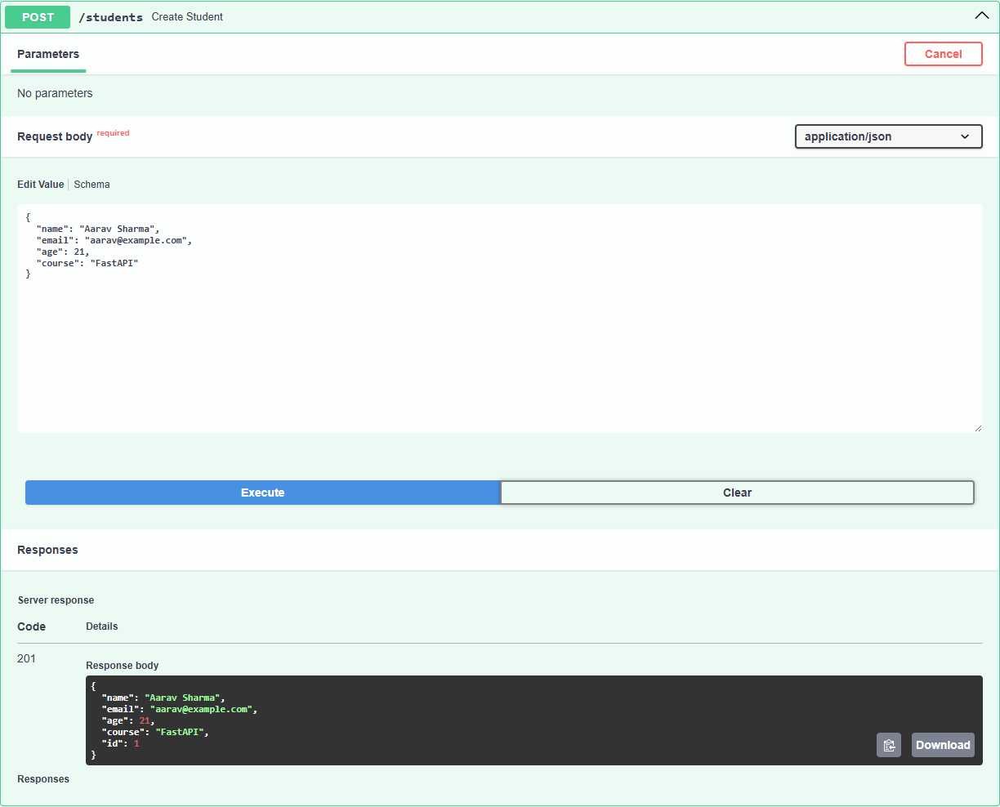
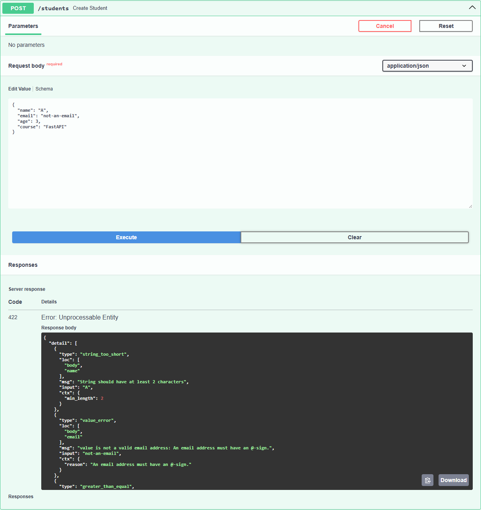

# Student CRUD API

A **FastAPI** application for managing students with the four basic operations:
**C**reate, **R**ead, **U**pdate and **D**elete. Every request body is validated with
**Pydantic**, and every response carries the right HTTP status code: 201, 200, 204,
404, 409 or 422.

Task 2 of the FastAPI module (05_api) in the 6 month FDE challenge.


---

## Table of contents

1. [Features](#features)
2. [Project structure](#project-structure)
3. [Modules, packages and OOP](#modules-packages-and-oop)
4. [How to run it](#how-to-run-it)
5. [Endpoints](#endpoints)
6. [Student fields and Pydantic validation](#student-fields-and-pydantic-validation)
7. [HTTP status codes](#http-status-codes)
8. [Custom exceptions](#custom-exceptions)
9. [Using Swagger UI](#using-swagger-ui)
10. [Example requests and real responses](#example-requests-and-real-responses)
11. [Limitations](#limitations)

---

## Features

- Create, list, fetch, update and delete students.
- Each student has `id`, `name`, `email`, `age` and `course`.
- The **server** assigns `id` (1, 2, 3, ...). The client never sends it.
- The email must be a real email format (`EmailStr`) and **unique**. Two students
  cannot share one address.
- Invalid data is rejected with `422` and a message for every field that failed,
  not just the first.
- Custom Pydantic validators clean the input: names are title-cased (`aarav sharma` → `Aarav Sharma`)
  and emails are lowercased, so `Aarav@Example.com` counts as the same email as `aarav@example.com`.
- Custom exception classes (`StudentNotFoundError`, `EmailTakenError`) with one handler.
- Interactive documentation at `/docs` (Swagger UI).

---

## Project structure

```
02_student_crud_api/
├── main.py              # creates the FastAPI app and plugs in the router
├── requirements.txt     # fastapi, uvicorn, email-validator
├── README.md
├── student_crud.png     # video thumbnail
├── screenshots/         # real Swagger UI screenshots
└── app/                 # the application package
    ├── __init__.py
    ├── exceptions.py    # custom exception classes + the one handler that turns them into JSON
    ├── schemas.py       # StudentCreate and Student (Pydantic) + custom validators
    ├── service.py       # StudentService class: the data and the CRUD logic
    └── routes.py        # the five endpoints under /students
```

`routes.py` receives the request and hands it to `StudentService`. The service
does the work and returns a `Student` model, which FastAPI turns into JSON.

---

## Modules, packages and OOP

| Concept | Where it is used |
|---|---|
| **Package** | `app/` is a package. `main.py` imports `from app.routes import router`. |
| **Modules** | `schemas.py` (data shape), `service.py` (logic), `routes.py` (HTTP). One job each. |
| **Class and object** | `StudentService` is a class; `routes.py` creates one object, `service = StudentService()`. |
| **Encapsulation** | The `students` dictionary and the `next_id` counter live inside the object. Only its methods change them. |
| **Method reuse** | `update()` and `delete()` both call `self.get(student_id)` first, so "student not found" is written once and behaves the same everywhere. |
| **Private helper** | `_check_email_free()` enforces the unique-email rule for both create and update. |
| **Inheritance** | `Student(StudentCreate)` inherits all four fields (and their validators) and adds `id`. |
| **Custom exception hierarchy** | `AppError(Exception)` is the parent; `StudentNotFoundError` and `EmailTakenError` inherit from it and build their own message in `__init__`. |
| **Overriding a class attribute** | Each exception sets its own `status_code` (404, 409); one handler reads it for all of them. |
| **Custom validators** | `@field_validator` class methods on `StudentCreate` for `name`, `email` and `course`. |

---

## How to run it

Needs **Python 3.10 or newer**.

```bash
cd 05_api/02_student_crud_api

python -m venv venv
venv\Scripts\activate            # Windows
# source venv/bin/activate       # macOS / Linux

pip install -r requirements.txt
uvicorn main:app --reload
```

Open **http://127.0.0.1:8000/docs** for Swagger UI.

---

## Endpoints

| Method | Path | Body | Success | Errors |
|---|---|---|---|---|
| POST | `/students` | student fields | **201** the new student | 409, 422 |
| GET | `/students` | - | **200** list of students | - |
| GET | `/students/{student_id}` | - | **200** one student | 404 |
| PUT | `/students/{student_id}` | student fields | **200** the updated student | 404, 409, 422 |
| DELETE | `/students/{student_id}` | - | **204** no body | 404 |

`PUT` replaces the whole record, so all four fields are required. The `id` stays the same.

---

## Student fields and Pydantic validation

Defined in [app/schemas.py](app/schemas.py):

```python
class StudentCreate(BaseModel):
    model_config = ConfigDict(str_strip_whitespace=True)   # trim text before any rule runs

    name: str = Field(min_length=2, max_length=50)
    email: EmailStr
    age: int = Field(ge=5, le=100)
    course: str = Field(min_length=2, max_length=50)

class Student(StudentCreate):
    id: int
```

| Field | Type | Built-in rule (`Field`) | Custom rule (`@field_validator`) | Sent by |
|---|---|---|---|---|
| `id` | int | assigned automatically | - | server |
| `name` | str | 2 to 50 characters | only letters, spaces, `.` `-` `'`; extra spaces removed; title-cased | client |
| `email` | EmailStr | valid email format | lowercased (then checked for uniqueness in the service) | client |
| `age` | int | 5 to 100 | - | client |
| `course` | str | 2 to 50 characters | must contain at least one letter | client |

### Custom validators

A `@field_validator` is a class method. It gets the value after the built-in checks
and either returns it, possibly cleaned up, or raises `ValueError`. Pydantic reports
that as a normal 422 entry.

```python
@field_validator("name")
@classmethod
def name_is_letters_only(cls, value):
    if not re.fullmatch(r"[A-Za-z .'-]+", value):
        raise ValueError("name may contain only letters, spaces, dots, hyphens and apostrophes")
    return " ".join(value.split()).title()        # "aarav   sharma" -> "Aarav Sharma"

@field_validator("email")
@classmethod
def email_lowercase(cls, value):
    return value.lower()
```

The email validator fixes a real gap. Without it, `aarav@example.com` and
`AARAV@example.com` are different strings, so the unique-email check would let a
second student register the same inbox.

Real results, from the running app:

| Sent | Result |
|---|---|
| `"name": "  aarav   sharma ", "email": "Aarav@Example.COM"` | 201, saved as `"Aarav Sharma"` / `"aarav@example.com"` |
| then `"email": "AARAV@example.com"` for another student | 409 `Email aarav@example.com is already used by student 1` |
| `"name": "R2D2"` | 422 `Value error, name may contain only letters, spaces, dots, hyphens and apostrophes` |
| `"course": "101"` | 422 `Value error, course must contain at least one letter` |

`EmailStr` uses the `email-validator` package, which is why it is in `requirements.txt`.

There are two models because the client and the server know different things. The
client sends `StudentCreate` (no `id`); the server answers with `Student` (with `id`).
If the client sends `"id": 99`, Pydantic simply ignores it.

---

## HTTP status codes

| Code | Meaning | When this API returns it |
|---|---|---|
| **201 Created** | a new resource was made | `POST /students` succeeded |
| **200 OK** | here is what you asked for | `GET` and `PUT` succeeded |
| **204 No Content** | done, nothing to send back | `DELETE` succeeded |
| **404 Not Found** | that id does not exist | `GET`, `PUT` or `DELETE` on an unknown id |
| **409 Conflict** | clashes with existing data | the email already belongs to another student |
| **422 Unprocessable Entity** | the body broke a validation rule | Pydantic rejected a field |

The success codes are set on each route with `status_code=201` or `status_code=204`.
The 404 and 409 errors are raised in the service as custom exceptions (next section).
FastAPI produces the 422 by itself from the Pydantic rules.

---

## Custom exceptions

[app/exceptions.py](app/exceptions.py)

```python
class AppError(Exception):                  # parent of every error we raise on purpose
    status_code = 400
    def __init__(self, message):
        super().__init__(message)
        self.message = message

class StudentNotFoundError(AppError):
    status_code = 404
    def __init__(self, student_id):
        super().__init__(f"Student {student_id} not found")

class EmailTakenError(AppError):
    status_code = 409
    def __init__(self, email, owner_id):
        super().__init__(f"Email {email} is already used by student {owner_id}")
```

The service raises them with just the data: `raise StudentNotFoundError(student_id)`.
Each class writes its own message, so the wording is the same everywhere it is raised.

`main.py` registers **one handler for the parent class**, and it serves every subclass:

```python
def app_error_handler(request, exc):
    return JSONResponse(status_code=exc.status_code, content={"detail": exc.message})

app.add_exception_handler(AppError, app_error_handler)
```

The response shape (`{"detail": "..."}`) is the same one FastAPI uses for its own
errors, so clients see a single, consistent error format. And `service.py` no longer
imports anything from FastAPI: it is plain Python that says *what* went wrong and
leaves *how HTTP reports it* to the handler.

---

## Using Swagger UI

1. Start the server and open http://127.0.0.1:8000/docs.
2. **POST /students**: *Try it out*, send
   `{"name": "Aarav Sharma", "email": "aarav@example.com", "age": 21, "course": "FastAPI"}`, *Execute*. You get `201` with `"id": 1`.
3. **GET /students** lists everyone. **GET /students/{student_id}** with `1` returns Aarav.
4. **PUT /students/{student_id}** with `1` and a new `age`/`course` returns the updated record.
5. **DELETE /students/{student_id}** returns `204`. A `GET` for the same id now returns `404`.
6. Try a bad body, such as `"email": "not-an-email"` or `"age": 3`, to see the `422` details.

**The five endpoints:**



**Creating a student returns 201 with the server-assigned id:**



**Three bad fields in one request give three validation errors:**



---

## Example requests and real responses

Captured from the running app, in this order, on a fresh start. The `curl` lines
are for Git Bash, macOS or Linux; on PowerShell use Swagger UI instead.

**Create: 201**
```bash
curl -X POST http://127.0.0.1:8000/students -H "Content-Type: application/json" -d '{"name": "Aarav Sharma", "email": "aarav@example.com", "age": 21, "course": "FastAPI"}'
```
```json
{ "name": "Aarav Sharma", "email": "aarav@example.com", "age": 21, "course": "FastAPI", "id": 1 }
```
A second student, Diya Patel (`diya@example.com`), was created the same way and got `"id": 2`.

**Read one: 200**
```bash
curl http://127.0.0.1:8000/students/1
```
```json
{ "name": "Aarav Sharma", "email": "aarav@example.com", "age": 21, "course": "FastAPI", "id": 1 }
```

**Update: 200**
```bash
curl -X PUT http://127.0.0.1:8000/students/1 -H "Content-Type: application/json" -d '{"name": "Aarav Sharma", "email": "aarav@example.com", "age": 22, "course": "Docker"}'
```
```json
{ "name": "Aarav Sharma", "email": "aarav@example.com", "age": 22, "course": "Docker", "id": 1 }
```

**Delete: 204**, then reading the same id: **404**
```bash
curl -X DELETE http://127.0.0.1:8000/students/2
curl http://127.0.0.1:8000/students/2
```
```json
{ "detail": "Student 2 not found" }
```

**Invalid body: 422.** One request broke three rules, and each one is reported:
```bash
curl -X POST http://127.0.0.1:8000/students -H "Content-Type: application/json" -d '{"name": "A", "email": "not-an-email", "age": 3, "course": "FastAPI"}'
```
```json
{
  "detail": [
    { "type": "string_too_short", "loc": ["body", "name"],
      "msg": "String should have at least 2 characters", "input": "A", "ctx": { "min_length": 2 } },
    { "type": "value_error", "loc": ["body", "email"],
      "msg": "value is not a valid email address: An email address must have an @-sign.",
      "input": "not-an-email", "ctx": { "reason": "An email address must have an @-sign." } },
    { "type": "greater_than_equal", "loc": ["body", "age"],
      "msg": "Input should be greater than or equal to 5", "input": 3, "ctx": { "ge": 5 } }
  ]
}
```

**Email already used: 409**
```bash
curl -X POST http://127.0.0.1:8000/students -H "Content-Type: application/json" -d '{"name": "Copy Cat", "email": "aarav@example.com", "age": 20, "course": "Git"}'
```
```json
{ "detail": "Email aarav@example.com is already used by student 1" }
```

**Update an id that doesn't exist: 404**
```bash
curl -X PUT http://127.0.0.1:8000/students/42 -H "Content-Type: application/json" -d '{"name": "Nobody", "email": "no@example.com", "age": 30, "course": "Git"}'
```
```json
{ "detail": "Student 42 not found" }
```

---

## Limitations

- Data lives **in memory** and resets when the server restarts.
- Ids are never reused: after deleting student 2, the next new student gets id 3.
- `.title()` is simple: it turns `mcdonald` into `Mcdonald`, not `McDonald`.
- There is no `PATCH` (partial update), because the task asked for `PUT` only.
