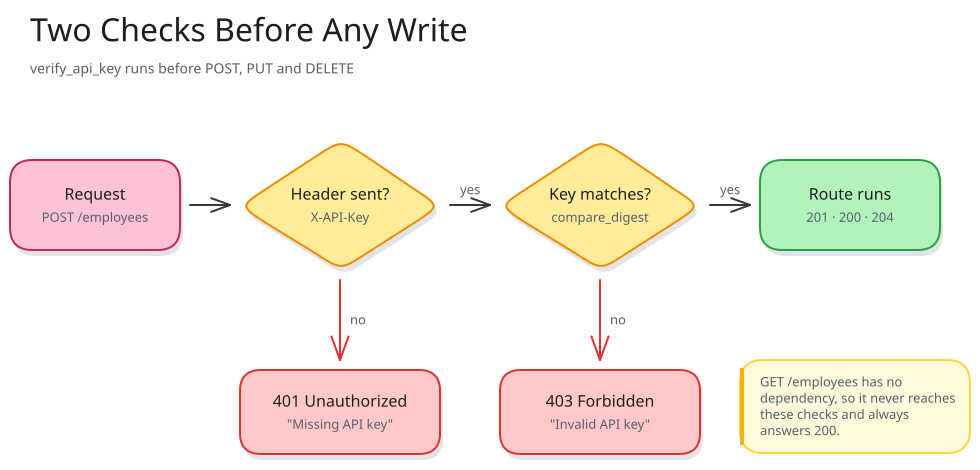
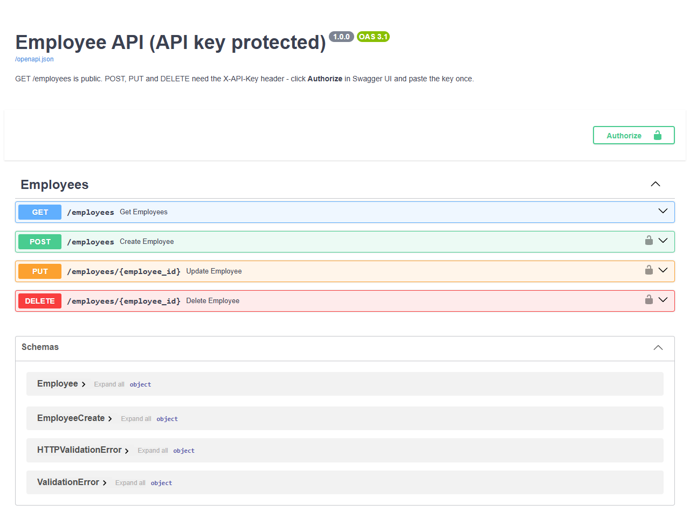
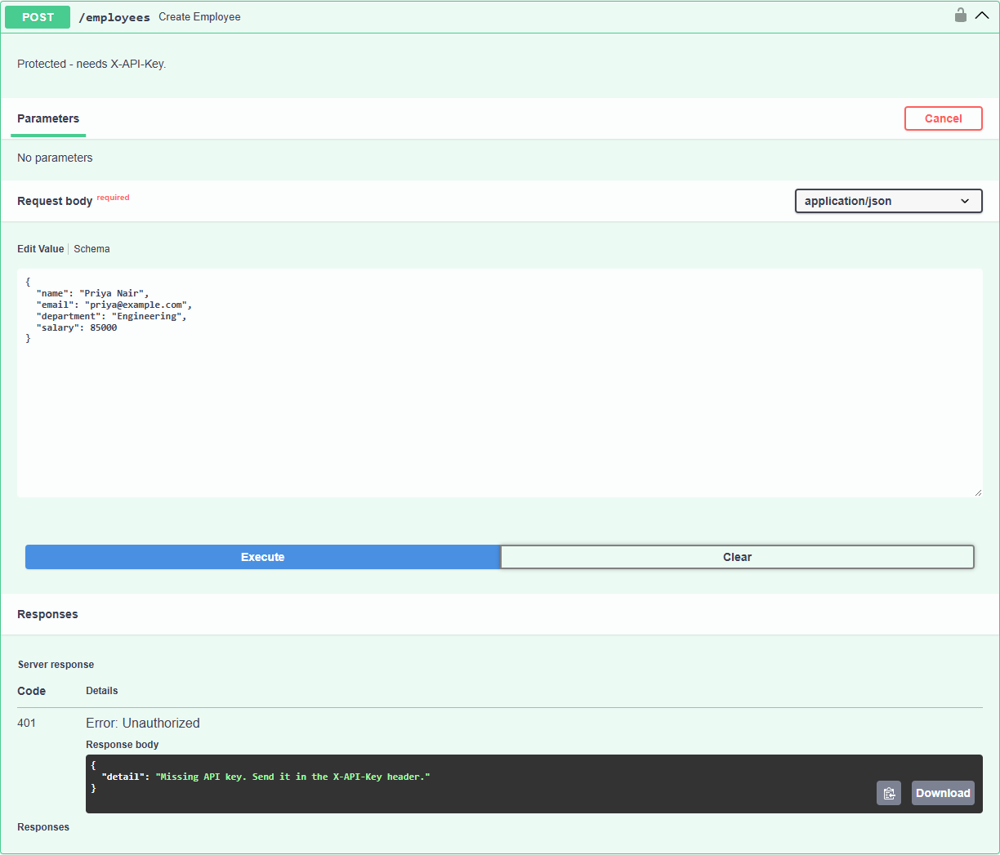
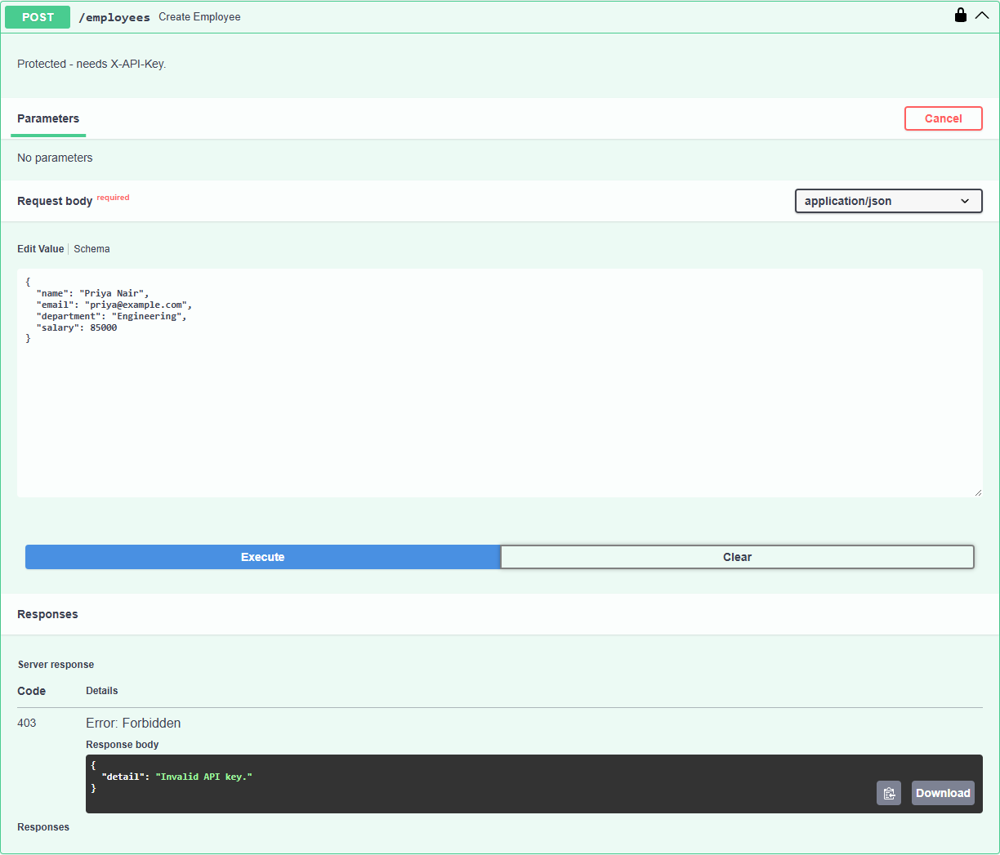
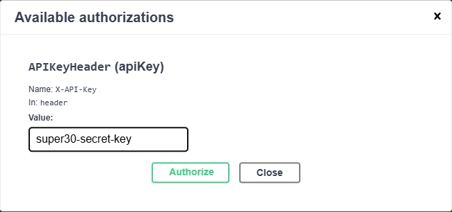
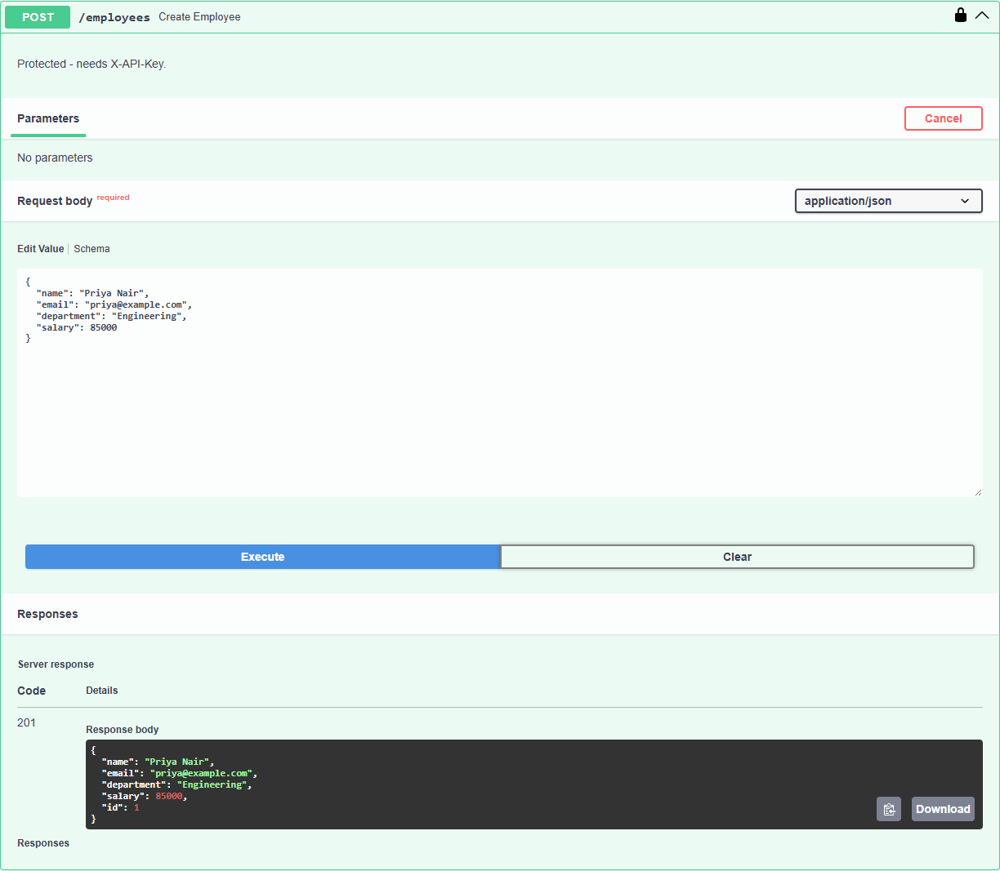

# API Key Protected Employee API

An Employee Management API built with **FastAPI** in which the endpoints that
**change data** need an API key. Anyone can read the employee list. Creating,
updating or deleting an employee requires the header `X-API-Key`. A missing key is
answered with **401**, a wrong key with **403**. Employee data is validated with
**Pydantic**.

This README explains the authentication logic, shows real successful and failed
requests, and explains how the key stays out of GitHub.

Task 3 of the FastAPI module (05_api) in the 6 month FDE challenge.


---

## Table of contents

1. [Features](#features)
2. [Project structure](#project-structure)
3. [Modules, packages and OOP](#modules-packages-and-oop)
4. [How to run it](#how-to-run-it)
5. [Endpoints: public and protected](#endpoints-public-and-protected)
6. [How the authentication works](#how-the-authentication-works)
7. [Keeping the key out of GitHub](#keeping-the-key-out-of-github)
8. [Employee validation](#employee-validation)
9. [Custom exceptions](#custom-exceptions)
10. [Using Swagger UI with the key](#using-swagger-ui-with-the-key)
11. [Successful and failed requests (real output)](#successful-and-failed-requests-real-output)
12. [Limitations](#limitations)

---

## Features

- `GET /employees` is **public**.
- `POST /employees`, `PUT /employees/{employee_id}` and `DELETE /employees/{employee_id}` are **protected**.
- No key returns `401 Unauthorized`; a wrong key returns `403 Forbidden`; the right key lets the request through.
- The key is read from an **environment variable** (`API_KEY`), and `.env` is git-ignored.
- The key is compared with `secrets.compare_digest`, a timing-safe comparison.
- Swagger UI has an **Authorize** button and a lock icon on each protected endpoint.
- Pydantic validation for every employee field (`422` on bad data), including custom
  validators: department must be one of six known departments, salary has at most 2 decimals,
  names are cleaned and title-cased, and emails are lowercased.
- Custom exception classes (`MissingApiKeyError`, `InvalidApiKeyError`, `EmployeeNotFoundError`)
  with one handler.

---

## Project structure

```
03_api_key_employee_api/
├── main.py              # creates the FastAPI app and plugs in the router
├── requirements.txt     # fastapi, uvicorn, email-validator, python-dotenv
├── .env.example         # template: copy to .env and put your own key in it
├── .gitignore           # keeps .env (the real key) out of Git
├── README.md
├── api_key_auth.png     # video thumbnail
├── docs/auth_flow.svg   # the diagram in this README (+ .excalidraw source)
├── screenshots/         # real Swagger UI screenshots
└── app/
    ├── __init__.py
    ├── config.py        # reads API_KEY from the environment / .env
    ├── exceptions.py    # custom exception classes + the one handler that turns them into JSON
    ├── security.py      # verify_api_key(): the 401 / 403 logic
    ├── schemas.py       # EmployeeCreate and Employee (Pydantic) + custom validators
    ├── service.py       # EmployeeService class: data + CRUD logic
    └── routes.py        # the four endpoints, three of them protected
```

Security has its own module. `service.py` knows nothing about keys, and
`security.py` knows nothing about employees, so either one can change without
touching the other.

---

## Modules, packages and OOP

| Concept | Where it is used |
|---|---|
| **Package** | `app/` is a package; `main.py` imports `from app.routes import router`. |
| **Modules** | `config.py` settings, `security.py` authentication, `schemas.py` data shape, `service.py` logic, `routes.py` HTTP. |
| **Class and object** | `EmployeeService` is a class; `routes.py` creates one object that every endpoint shares. |
| **Encapsulation** | The `employees` dictionary and `next_id` counter live inside the object and change only through its methods. |
| **Private helper** | `_check_exists()` raises the 404 for both `update()` and `delete()`. |
| **Inheritance** | `Employee(EmployeeCreate)` inherits the four fields (and their validators) and adds `id`. |
| **Custom exception hierarchy** | `AppError(Exception)` is the parent of `MissingApiKeyError`, `InvalidApiKeyError` and `EmployeeNotFoundError`. |
| **Overriding class attributes** | Each exception sets its own `status_code` (401, 403, 404); `MissingApiKeyError` also overrides `headers` to add `WWW-Authenticate`. One handler reads both for every subclass. |
| **Custom validators** | `@field_validator` class methods on `EmployeeCreate` for `name`, `email`, `department` and `salary`. |
| **Separation of concerns** | Authentication is a *dependency* attached to routes, not code copied into each route. |

---

## How to run it

Needs **Python 3.10 or newer**.

```bash
cd 05_api/03_api_key_employee_api

python -m venv venv
venv\Scripts\activate            # Windows
# source venv/bin/activate       # macOS / Linux

pip install -r requirements.txt

# optional: choose your own key
copy .env.example .env           # Windows   (cp .env.example .env on macOS / Linux)
# then edit .env:  API_KEY=your-own-long-random-key

uvicorn main:app --reload
```

Open **http://127.0.0.1:8000/docs**.

**If you skip the `.env` step**, the app uses the demo key from the task statement,
`super30-secret-key`, so it runs straight from a fresh clone. That key is public
(it is printed in the task), so it is only for trying the app locally. Set your own
key for anything else. All examples below use the demo key.

---

## Endpoints: public and protected

| Method | Path | Needs `X-API-Key`? | Success | Errors |
|---|---|---|---|---|
| GET | `/employees` | no | **200** list | - |
| POST | `/employees` | **yes** | **201** new employee | 401, 403, 422 |
| PUT | `/employees/{employee_id}` | **yes** | **200** updated employee | 401, 403, 404, 422 |
| DELETE | `/employees/{employee_id}` | **yes** | **204** no body | 401, 403, 404 |

Reading is public and writing is protected. This is a common pattern: anyone may
look at the list, but only a trusted client may change it.

---

## How the authentication works



*Figure 1: the key check runs before the endpoint. Only a request that passes both
checks reaches the route. GET /employees has no check at all.*

### Step 1: tell FastAPI where the key lives

[app/security.py](app/security.py)
```python
api_key_header = APIKeyHeader(name="X-API-Key", auto_error=False)
```

`APIKeyHeader` reads the `X-API-Key` header from each request. It also registers
the scheme in the OpenAPI document, which is what gives Swagger UI its **Authorize**
button. `auto_error=False` means "if the header is missing, give me `None` and let
me decide". Without it FastAPI would send its own generic error, and we could not
tell "missing" apart from "wrong".

### Step 2: check the key

```python
def verify_api_key(api_key: str | None = Security(api_key_header)) -> str:
    if not api_key:                                        # no header at all
        raise MissingApiKeyError()                         # -> 401
    if not secrets.compare_digest(api_key, API_KEY):       # header present, value wrong
        raise InvalidApiKeyError()                         # -> 403
    return api_key                                         # correct: let the route run
```

The two errors are custom exception classes; see [Custom exceptions](#custom-exceptions).

| What the client sent | Result | Why this code |
|---|---|---|
| no `X-API-Key` header (or an empty one) | **401 Unauthorized** | "I don't know who you are." The client never tried to authenticate. The `WWW-Authenticate` header says how to. |
| `X-API-Key: wrong-key` | **403 Forbidden** | "You tried, and the answer is no." Sending the same request again will not help. |
| `X-API-Key: super30-secret-key` | the route runs (201 / 200 / 204) | the key matches |

**Why `secrets.compare_digest` instead of `==`?** A normal `==` stops at the first
character that differs, so a wrong key that starts correctly takes a tiny bit longer
to reject. An attacker who measures many response times could use that to guess the
key one character at a time. `compare_digest` always takes the same time, whatever
the input.

### Step 3: attach the check to the protected routes

[app/routes.py](app/routes.py)
```python
PROTECTED = [Depends(verify_api_key)]

@router.get("")                                              # public
def get_employees(): ...

@router.post("", status_code=201, dependencies=PROTECTED)   # protected
def create_employee(employee: EmployeeCreate): ...
```

`dependencies=PROTECTED` tells FastAPI to run `verify_api_key` **before** the route.
If it raises an error, the route body never runs, so the employee data is never
touched. The key check also runs before the body is validated. A request with no key
*and* a broken body gets `401`, not `422`, which means an unauthenticated caller
learns nothing about the data format. (This was tested: `{"name": "X"}` with no key
returned 401; the same body with the right key returned 422.)

Adding protection to a new endpoint is one argument, and removing it is deleting
that argument. No key-checking code is repeated inside the routes.

---

## Keeping the key out of GitHub

[app/config.py](app/config.py)
```python
load_dotenv(Path(__file__).parent.parent / ".env")    # reads this project's .env, if present
DEMO_API_KEY = "super30-secret-key"
API_KEY = os.getenv("API_KEY", DEMO_API_KEY)
```

| File | In Git? | Contains |
|---|---|---|
| `.env.example` | yes | a placeholder: `API_KEY=change-me-to-a-long-random-string` |
| `.env` | **no**, listed in `.gitignore` | your real key |

- The real key goes in `.env`, and `.gitignore` keeps `.env` out of every commit.
  `git check-ignore -v .env` confirms it: `.gitignore:1:.env`.
- `.env.example` shows teammates *which* variable to set, without a value.
- The only key in the code is the public demo key from the task statement, used
  only when `API_KEY` is not set.
- On a server you would set `API_KEY` as a real environment variable and not use a
  `.env` file at all.

This was tested: with `API_KEY=my-local-test-key` in `.env`, the demo key
`super30-secret-key` was rejected with **403**, and `my-local-test-key` was accepted
with **201**.

---

## Employee validation

[app/schemas.py](app/schemas.py)

| Field | Type | Built-in rule (`Field`) | Custom rule (`@field_validator`) |
|---|---|---|---|
| `id` | int | assigned by the server | - |
| `name` | str | 2 to 50 characters | only letters, spaces, `.` `-` `'`; extra spaces removed; title-cased |
| `email` | EmailStr | valid email format | lowercased |
| `department` | str | 2 to 30 characters | one of `Engineering, HR, Finance, Sales, Marketing, Operations`, any capitalisation; stored in the official spelling |
| `salary` | float | greater than 0, at most 10,000,000 | at most 2 decimal places |

`model_config = ConfigDict(str_strip_whitespace=True)` trims text fields before
any rule runs.

Validation runs only once the key has been accepted, so a request with a valid key
and a bad body gets `422` with one message per failed field.

### Custom validators

```python
DEPARTMENTS = ["Engineering", "HR", "Finance", "Sales", "Marketing", "Operations"]

@field_validator("department")
@classmethod
def department_is_known(cls, value):
    for dept in DEPARTMENTS:
        if value.lower() == dept.lower():
            return dept                      # "engineering" -> "Engineering"
    raise ValueError(f"department must be one of: {', '.join(DEPARTMENTS)}")

@field_validator("salary")
@classmethod
def salary_two_decimals(cls, value):
    if round(value, 2) != value:
        raise ValueError("salary may have at most 2 decimal places")
    return value
```

A validator either returns the value (possibly cleaned) or raises `ValueError`,
which Pydantic reports as a normal 422 entry. The department check means the list
never fills up with `"engg"`, `"Engg."` and `"engineering"` as three different departments.

Real results, all sent with the right key:

| Sent | Result |
|---|---|
| `"name": "  priya nair ", "email": "Priya@Example.com", "department": "engineering", "salary": 85000.5` | 201, saved as `"Priya Nair"`, `"priya@example.com"`, `"Engineering"`, `85000.5` |
| `"department": "Space Travel"` | 422 `Value error, department must be one of: Engineering, HR, Finance, Sales, Marketing, Operations` |
| `"salary": 50000.123` | 422 `Value error, salary may have at most 2 decimal places` |
| `"name": "Ravi@Kumar"` | 422 `Value error, name may contain only letters, spaces, dots, hyphens and apostrophes` |

---

## Custom exceptions

[app/exceptions.py](app/exceptions.py)

```python
class AppError(Exception):                   # parent of every error we raise on purpose
    status_code = 400
    headers = None
    def __init__(self, message):
        super().__init__(message)
        self.message = message

class MissingApiKeyError(AppError):          # no X-API-Key -> 401
    status_code = 401
    headers = {"WWW-Authenticate": "APIKey"}
    def __init__(self):
        super().__init__("Missing API key. Send it in the X-API-Key header.")

class InvalidApiKeyError(AppError):          # wrong X-API-Key -> 403
    status_code = 403
    def __init__(self):
        super().__init__("Invalid API key.")

class EmployeeNotFoundError(AppError):       # unknown employee id -> 404
    status_code = 404
    def __init__(self, employee_id):
        super().__init__(f"Employee {employee_id} not found")
```

`main.py` registers **one handler for the parent class**, and it serves all of them.
That works even for errors raised inside the `verify_api_key` dependency:

```python
def app_error_handler(request, exc):
    return JSONResponse(status_code=exc.status_code, content={"detail": exc.message}, headers=exc.headers)

app.add_exception_handler(AppError, app_error_handler)
```

What this gives you:

- **Each error has a name.** `raise InvalidApiKeyError()` says what happened. The
  status code, message and headers are defined once, in the class.
- **The 401 keeps its `WWW-Authenticate: APIKey` header**, because that subclass
  overrides `headers`. This was checked on the running app with `curl -i`.
- **`service.py` and `security.py` do not import `HTTPException`.** They raise plain
  Python exceptions, and only the handler knows about HTTP.

---

## Using Swagger UI with the key

1. Open http://127.0.0.1:8000/docs. The protected endpoints show an **open lock** icon.
2. Try **POST /employees** first *without* authorising: *Try it out*, then *Execute*. You get **401**.
3. Click **Authorize** (top right), type `wrong-key`, click *Authorize*, then *Close*. *Execute* again: **403**.
4. Click **Authorize**, then *Logout*, type `super30-secret-key`, then *Authorize* and *Close*. The locks close.
5. *Execute* again: **201**. Swagger UI now sends `X-API-Key` with every protected request.

**Public GET, and three protected endpoints with lock icons:**



**No key: 401**



**Wrong key: 403**



**The Authorize dialog, with the key sent as the X-API-Key header:**



**Right key: 201**



---

## Successful and failed requests (real output)

Captured from the running app, in this order, on a fresh start with no `.env`.
The `curl` lines are for Git Bash, macOS or Linux.

**1. Public read, no key needed: 200**
```bash
curl http://127.0.0.1:8000/employees
```
```json
[]
```

**2. Create without a key: 401**
```bash
curl -X POST http://127.0.0.1:8000/employees -H "Content-Type: application/json" -d '{"name": "Priya Nair", "email": "priya@example.com", "department": "Engineering", "salary": 85000}'
```
```json
{ "detail": "Missing API key. Send it in the X-API-Key header." }
```

**3. Create with a wrong key: 403**
```bash
curl -X POST http://127.0.0.1:8000/employees -H "X-API-Key: wrong-key" -H "Content-Type: application/json" -d '{"name": "Priya Nair", "email": "priya@example.com", "department": "Engineering", "salary": 85000}'
```
```json
{ "detail": "Invalid API key." }
```

**4. Create with the right key: 201**
```bash
curl -X POST http://127.0.0.1:8000/employees -H "X-API-Key: super30-secret-key" -H "Content-Type: application/json" -d '{"name": "Priya Nair", "email": "priya@example.com", "department": "Engineering", "salary": 85000}'
```
```json
{ "name": "Priya Nair", "email": "priya@example.com", "department": "Engineering", "salary": 85000.0, "id": 1 }
```

**5. Update with the right key: 200**
```bash
curl -X PUT http://127.0.0.1:8000/employees/1 -H "X-API-Key: super30-secret-key" -H "Content-Type: application/json" -d '{"name": "Priya Nair", "email": "priya@example.com", "department": "Engineering", "salary": 95000}'
```
```json
{ "name": "Priya Nair", "email": "priya@example.com", "department": "Engineering", "salary": 95000.0, "id": 1 }
```

**6. Update without a key: 401.** The salary is *not* changed to 1.
```bash
curl -X PUT http://127.0.0.1:8000/employees/1 -H "Content-Type: application/json" -d '{"name": "Priya Nair", "email": "priya@example.com", "department": "Engineering", "salary": 1}'
```
```json
{ "detail": "Missing API key. Send it in the X-API-Key header." }
```

**7. Right key, bad data: 422**
```bash
curl -X POST http://127.0.0.1:8000/employees -H "X-API-Key: super30-secret-key" -H "Content-Type: application/json" -d '{"name": "X", "email": "bad", "department": "HR", "salary": -5}'
```
```json
{
  "detail": [
    { "type": "string_too_short", "loc": ["body", "name"], "msg": "String should have at least 2 characters", "input": "X", "ctx": { "min_length": 2 } },
    { "type": "value_error", "loc": ["body", "email"], "msg": "value is not a valid email address: An email address must have an @-sign.", "input": "bad", "ctx": { "reason": "An email address must have an @-sign." } },
    { "type": "greater_than", "loc": ["body", "salary"], "msg": "Input should be greater than 0", "input": -5, "ctx": { "gt": 0.0 } }
  ]
}
```

**8. Right key, unknown id: 404**
```bash
curl -X DELETE http://127.0.0.1:8000/employees/7 -H "X-API-Key: super30-secret-key"
```
```json
{ "detail": "Employee 7 not found" }
```

**9. Delete with a wrong key: 403**, then **10. with the right key: 204** (no body)
```bash
curl -X DELETE http://127.0.0.1:8000/employees/1 -H "X-API-Key: wrong-key"
curl -X DELETE http://127.0.0.1:8000/employees/1 -H "X-API-Key: super30-secret-key"
```
```json
{ "detail": "Invalid API key." }
```

---

## Limitations

- There is one shared key for every client. A real system would give each client its
  own key, store only a hash of it, and let keys be revoked.
- API keys should only travel over **HTTPS** in production; on plain HTTP anyone on
  the network can read the header.
- Data lives in memory and resets when the server restarts.
