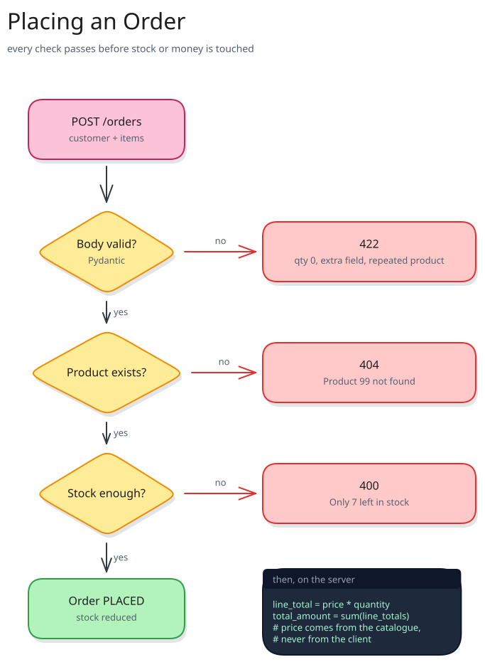
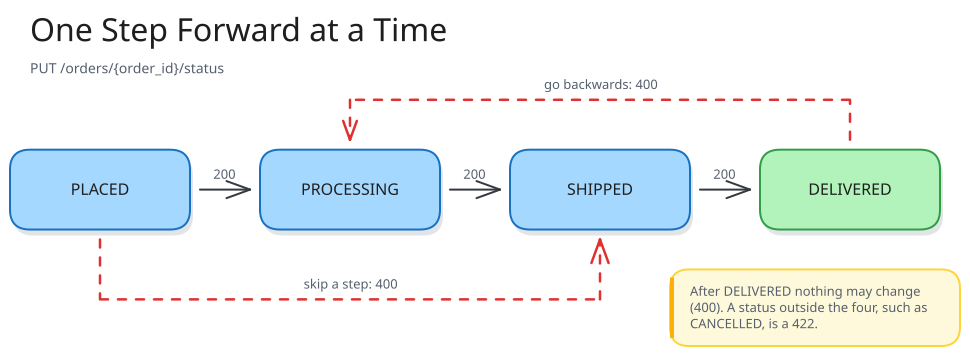
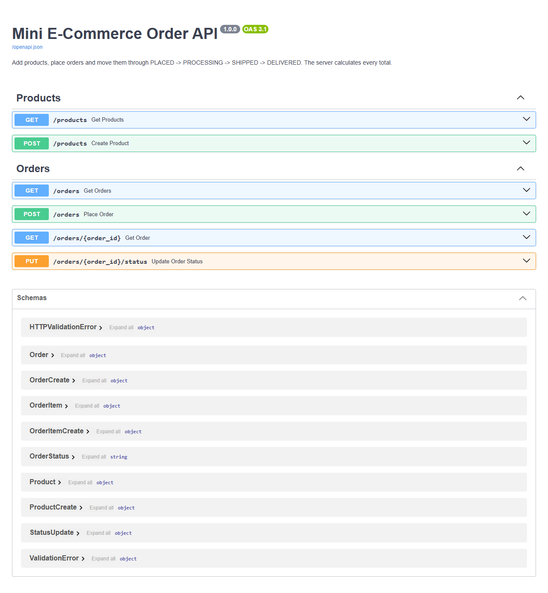
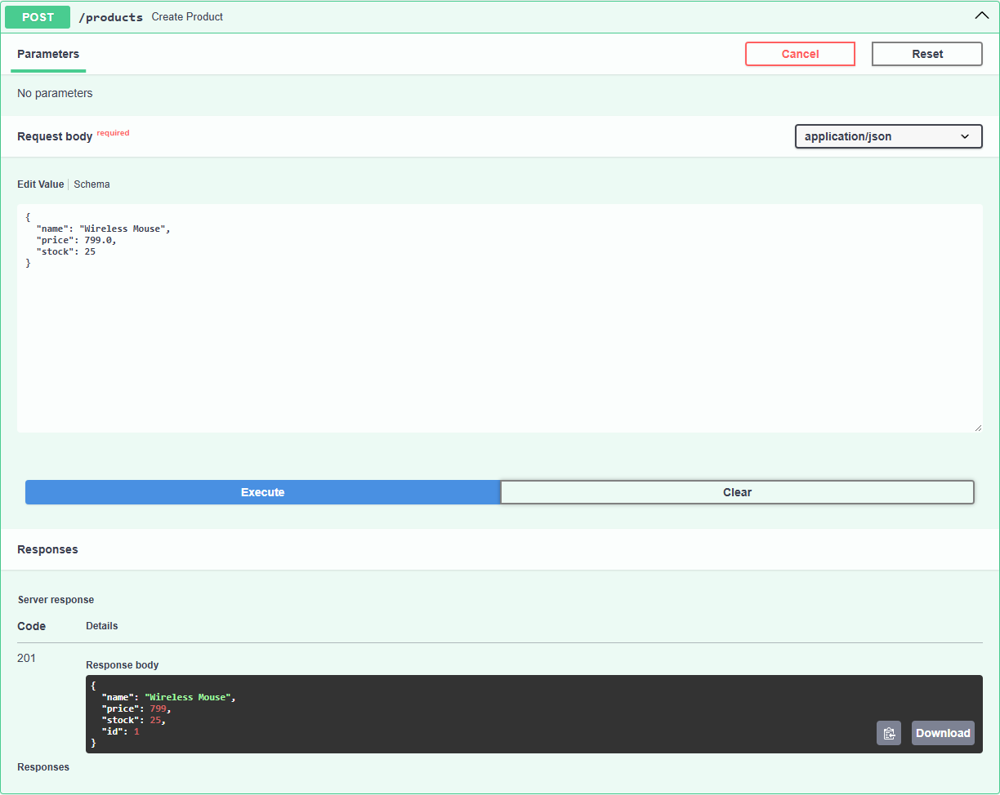
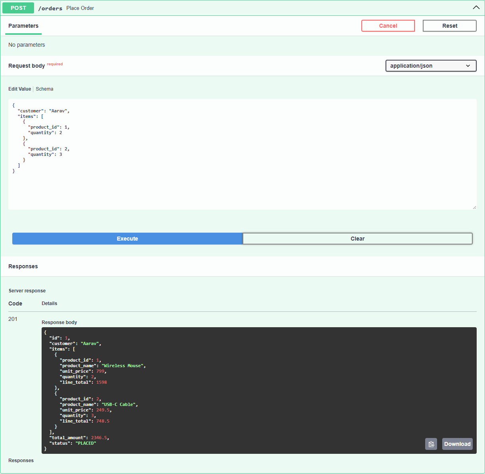
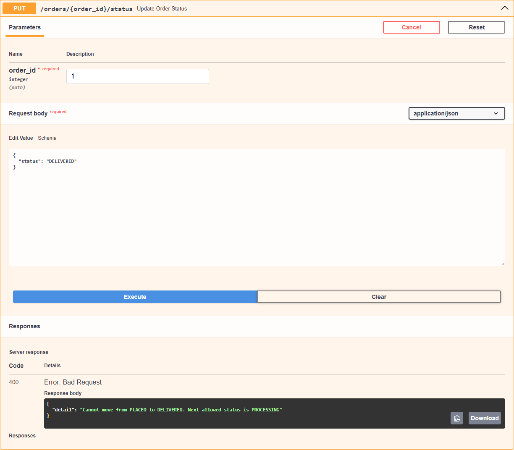
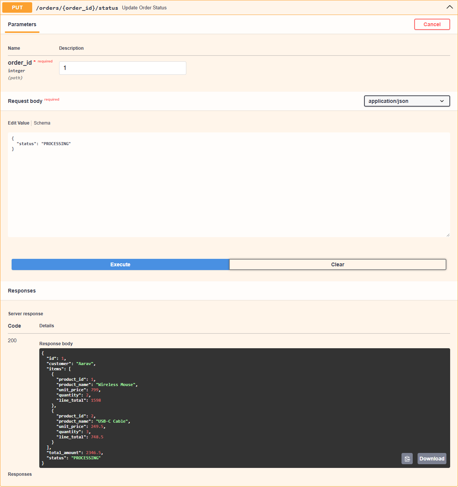
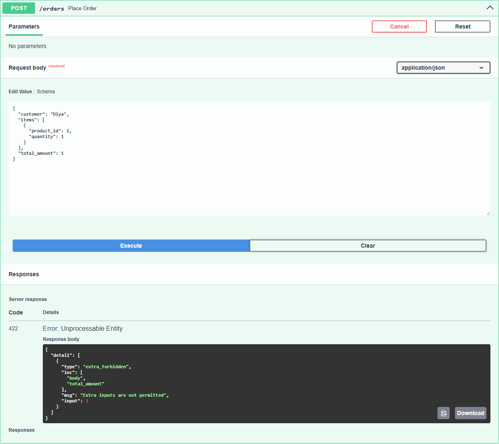

# Mini E-Commerce Order API

A small **FastAPI** backend for placing orders. You add products to a catalogue,
place an order for a customer, and move the order through
**PLACED → PROCESSING → SHIPPED → DELIVERED**. The server checks that every product
exists, that every quantity is valid and in stock, and it **calculates the total
itself**. It never accepts a price or a total from the client.

This README explains the API design and the validation, and walks through the
complete order flow in Swagger UI.

Task 4 of the FastAPI module (05_api) in the 6 month FDE challenge.


---

## Table of contents

1. [Features](#features)
2. [Project structure](#project-structure)
3. [Modules, packages and OOP](#modules-packages-and-oop)
4. [How to run it](#how-to-run-it)
5. [Endpoints](#endpoints)
6. [API design](#api-design)
7. [Validation](#validation)
8. [Custom exceptions](#custom-exceptions)
9. [Order status flow](#order-status-flow)
10. [The complete order flow in Swagger UI](#the-complete-order-flow-in-swagger-ui)
11. [Error cases in Swagger UI](#error-cases-in-swagger-ui)
12. [Real requests and responses](#real-requests-and-responses)
13. [Limitations](#limitations)

---

## Features

- `POST /products`, `GET /products`: build and view the catalogue (name, price, stock).
- `POST /orders`: place an order with a customer and a list of `{product_id, quantity}` items.
- `GET /orders`, `GET /orders/{order_id}`: view orders.
- `PUT /orders/{order_id}/status`: move an order one step forward.
- Each order stores the customer, every product with its unit price, quantity and
  line total, the **total amount** and the **status**.
- The total is **calculated on the server** from catalogue prices. A client that
  sends `total_amount` is rejected.
- Stock goes down when an order is placed. An order larger than the stock is refused.
- An order is all-or-nothing: if any item fails, nothing is saved and no stock changes.
- Custom Pydantic validators: price has at most 2 decimals, product names must contain
  a letter, and customer names are cleaned and title-cased.
- Custom exception classes (`NotFoundError`, `OutOfStockError`, `InvalidStatusChangeError`)
  with one handler.

---

## Project structure

```
04_ecommerce_order_api/
├── main.py                  # creates the FastAPI app and plugs in the router
├── requirements.txt         # fastapi, uvicorn
├── README.md
├── ecommerce_orders.png     # video thumbnail
├── docs/                    # the two diagrams in this README (.svg + .excalidraw source)
├── screenshots/             # real Swagger UI screenshots
└── app/
    ├── __init__.py
    ├── exceptions.py        # custom exception classes + the one handler that turns them into JSON
    ├── schemas.py           # OrderStatus enum + Pydantic models + custom validators
    ├── service.py           # ProductService and OrderService classes
    └── routes.py            # the six endpoints
```

---

## Modules, packages and OOP

| Concept | Where it is used |
|---|---|
| **Package** | `app/` is a package; `main.py` imports `from app.routes import router`. |
| **Modules** | `schemas.py` data shapes, `service.py` business rules, `routes.py` HTTP. |
| **Classes and objects** | `ProductService` and `OrderService`. `routes.py` creates one object of each. |
| **Composition** | `OrderService(product_service)` is *given* the product service and uses it to look up prices and stock. Orders and products share one catalogue without either class copying the other's data. |
| **Encapsulation** | Each service keeps its own dictionary and id counter; routes only call methods. |
| **Enum class** | `OrderStatus(str, Enum)` limits the status to exactly four values. |
| **Inheritance** | `Product(ProductCreate)` inherits name, price and stock and adds `id`. |
| **Custom validators** | `@field_validator` class methods: `price` (2 decimals), product `name`, `customer`, and `items` (no repeated product). |
| **Custom exception hierarchy** | `AppError(Exception)` is the parent of `NotFoundError`, `OutOfStockError` and `InvalidStatusChangeError`. |
| **Overriding a class attribute** | Each exception sets its own `status_code` (404, 400); one handler reads it for all of them. |

---

## How to run it

Needs **Python 3.10 or newer**.

```bash
cd 05_api/04_ecommerce_order_api

python -m venv venv
venv\Scripts\activate            # Windows
# source venv/bin/activate       # macOS / Linux

pip install -r requirements.txt
uvicorn main:app --reload
```

Open **http://127.0.0.1:8000/docs** for Swagger UI. Everything in this README,
the happy path and every error, can be run from there.

---

## Endpoints

| Method | Path | Body | Success | Errors |
|---|---|---|---|---|
| POST | `/products` | `{"name", "price", "stock"}` | **201** new product | 422 |
| GET | `/products` | - | **200** list | - |
| POST | `/orders` | `{"customer", "items": [{"product_id", "quantity"}]}` | **201** new order | 400, 404, 422 |
| GET | `/orders` | - | **200** list | - |
| GET | `/orders/{order_id}` | - | **200** one order | 404 |
| PUT | `/orders/{order_id}/status` | `{"status"}` | **200** updated order | 400, 404, 422 |

---

## API design

### What goes in is not what comes out

The request and the response of `POST /orders` are different models, on purpose:

| Client sends (`OrderCreate`) | Server returns (`Order`) |
|---|---|
| `customer` | `id` (assigned) |
| `items[].product_id` | `customer` |
| `items[].quantity` | `items[].product_id`, `product_name`, `unit_price`, `quantity`, `line_total` |
| | `total_amount` (calculated) |
| | `status` (always starts as `PLACED`) |

The client can say only *what* it wants and *how many*. Everything with money in it
comes from the server.

### Why the server calculates the total

If the API accepted `total_amount` from the client, anyone could send
`{"items": [{"product_id": 1, "quantity": 100}], "total_amount": 1}` and buy 100 mice for ₹1.
Request bodies are easy to edit, in Swagger UI or with `curl`. So the rule
is to **trust the client for intent, never for price**:

```python
# app/service.py - OrderService.place()
line_total = round(product.price * item.quantity, 2)          # price from OUR catalogue
total = round(sum(i.line_total for i in order_items), 2)
```

`OrderCreate` also sets `model_config = ConfigDict(extra="forbid")`, so a body that
includes `total_amount` (or `status`, or anything else unlisted) gets `422 Extra inputs are not permitted`.
The client learns straight away that the field is not accepted, instead of it being
silently ignored.

Each order item also stores `unit_price` and `product_name` *at the time of the order*.
If the product's price changes later, old orders still show what the customer paid.

### Check everything, then change anything



*Figure 1: `POST /orders` in four gates. Pydantic rejects a malformed body before
our code runs. The service then checks every item for existence and stock **before**
it reduces any stock. The prices and totals are worked out only after all the checks pass.*

`place()` loops over the items twice: first only to check, then to reduce stock and
build the lines. With a single loop, an order for `[mouse × 2, cable × 50]` would
reduce the mouse stock and then fail on the cable, leaving the catalogue wrong. With
two loops, a failing order changes nothing.

### Status codes

| Code | Used for |
|---|---|
| 201 | a product or an order was created |
| 200 | a read, or a successful status change |
| 400 | the request is well formed but breaks a business rule: not enough stock, or a status change that is not allowed |
| 404 | the product or order id does not exist |
| 422 | the body fails Pydantic validation: wrong type, quantity 0, an unknown status, an extra field, a repeated product |

---

## Validation

**Pydantic (422)**: [app/schemas.py](app/schemas.py). These rules run before any service code.

| Model | Field | Built-in rule (`Field` / type) | Custom rule (`@field_validator`) |
|---|---|---|---|
| `ProductCreate` | `name` | 2 to 100 characters | must contain a letter; repeated spaces collapse to one |
| | `price` | greater than 0, at most 1,000,000 | **at most 2 decimal places** |
| | `stock` | 0 to 100,000 | - |
| `OrderCreate` | `customer` | 2 to 50 characters | only letters, spaces, `.` `-` `'`; title-cased |
| | `items` | 1 to 20 items | **each product at most once** |
| | *anything else* | forbidden (`extra="forbid"`), which is how `total_amount` is blocked | - |
| `OrderItemCreate` | `product_id` | whole number > 0 | - |
| | `quantity` | whole number from **1 to 100** | - |
| `StatusUpdate` | `status` | exactly one of `PLACED`, `PROCESSING`, `SHIPPED`, `DELIVERED` (enum) | - |

Text fields are trimmed first (`str_strip_whitespace=True`), so `"  Wireless    Mouse "`
is saved as `"Wireless Mouse"`.

### Custom validators

A `@field_validator` is a class method. It either returns the value, possibly
cleaned up, or raises `ValueError`, which Pydantic reports as a normal 422 entry.

```python
@field_validator("price")
@classmethod
def price_two_decimals(cls, value):
    # money has paise, not fractions of paise: 799.99 is fine, 799.999 is not
    if round(value, 2) != value:
        raise ValueError("price may have at most 2 decimal places")
    return value
```

Why the price rule matters here: every total is `price × quantity`, summed. A price
like `1499.999` would make totals that no invoice can show, so it is refused at the door.

Real results, from the running app:

| Sent | Result |
|---|---|
| `POST /products` `"name": "  Wireless    Mouse ", "price": 799.99` | 201, saved as `"Wireless Mouse"`, `799.99` |
| `POST /products` `"price": 1499.999` | 422 `Value error, price may have at most 2 decimal places` |
| `POST /products` `"name": "12345"` | 422 `Value error, product name must contain at least one letter` |
| `POST /orders` `"customer": "  aarav  sharma "` | 201, saved as `"Aarav Sharma"`, `total_amount` 799.99 |
| `POST /orders` `"customer": "Aarav123"` | 422 `Value error, customer may contain only letters, spaces, dots, hyphens and apostrophes` |

**Service rules (404 / 400)**: [app/service.py](app/service.py). These need the stored data.

| Rule | Exception raised | Status | Example `detail` |
|---|---|---|---|
| product must exist | `NotFoundError` | 404 | `Product 99 not found` |
| quantity must be ≤ stock | `OutOfStockError` | 400 | `Only 7 'USB-C Cable' left in stock, you asked for 50` |
| order must exist | `NotFoundError` | 404 | `Order 99 not found` |
| status must move exactly one step forward | `InvalidStatusChangeError` | 400 | `Cannot move from PLACED to DELIVERED. Next allowed status is PROCESSING` |
| a DELIVERED order cannot change | `InvalidStatusChangeError` | 400 | `Order is already DELIVERED - status cannot change` |

Why is the same product listed twice an error? `[mouse × 1, mouse × 2]` would be
checked against stock item by item, so each line could pass while the two together
ask for more than is left. Asking for one line with `quantity: 3` keeps the stock
check honest.

---

## Custom exceptions

[app/exceptions.py](app/exceptions.py)

```python
class AppError(Exception):                  # parent of every error we raise on purpose
    status_code = 400
    def __init__(self, message):
        super().__init__(message)
        self.message = message

class NotFoundError(AppError):              # product or order id missing
    status_code = 404

class OutOfStockError(AppError):            # asks for more than the catalogue has
    status_code = 400
    def __init__(self, product_name, in_stock, asked):
        super().__init__(f"Only {in_stock} '{product_name}' left in stock, you asked for {asked}")

class InvalidStatusChangeError(AppError):   # not the next status in the flow
    status_code = 400
```

The service raises them by name. Their message and status code live in the class,
not at every `raise`:

```python
if item.quantity > product.stock:
    raise OutOfStockError(product.name, product.stock, item.quantity)
```

`main.py` registers **one handler for the parent class**, and it serves every subclass:

```python
def app_error_handler(request, exc):
    return JSONResponse(status_code=exc.status_code, content={"detail": exc.message})

app.add_exception_handler(AppError, app_error_handler)
```

Why custom exceptions instead of FastAPI's `HTTPException`?

- **The services are plain Python.** `service.py` imports nothing from FastAPI. The
  rules could be reused in a script, a CLI or a background job.
- **The names say what went wrong.** `OutOfStockError` and `InvalidStatusChangeError`
  are both 400s, but code that catches them can tell them apart.
- **One consistent error shape.** Every error, ours and FastAPI's, comes back as `{"detail": ...}`.

---

## Order status flow



*Figure 2: `PUT /orders/{order_id}/status` accepts only the next status. Skipping a
step or going back returns 400, and so does any change after DELIVERED. A value that
is not one of the four is rejected by the enum with 422.*

```python
STATUS_FLOW = [PLACED, PROCESSING, SHIPPED, DELIVERED]
allowed = STATUS_FLOW[current + 1]      # the one and only next status
```

An order that says SHIPPED must really have been PROCESSING first, so a real shop
never lets a status jump.

---

## The complete order flow in Swagger UI

Start the server and open http://127.0.0.1:8000/docs. Then, top to bottom:

| # | Endpoint | Body / parameter | Expect |
|---|---|---|---|
| 1 | POST /products | `{"name": "Wireless Mouse", "price": 799.0, "stock": 25}` | 201, `id` 1 |
| 2 | POST /products | `{"name": "USB-C Cable", "price": 249.5, "stock": 10}` | 201, `id` 2 |
| 3 | GET /products | - | both products |
| 4 | POST /orders | `{"customer": "Aarav", "items": [{"product_id": 1, "quantity": 2}, {"product_id": 2, "quantity": 3}]}` | 201, `total_amount` **2346.5**, status `PLACED` |
| 5 | GET /orders/{order_id} | `1` | the same order |
| 6 | PUT /orders/{order_id}/status | `1`, `{"status": "PROCESSING"}` | 200 |
| 7 | PUT /orders/{order_id}/status | `1`, `{"status": "SHIPPED"}` | 200 |
| 8 | PUT /orders/{order_id}/status | `1`, `{"status": "DELIVERED"}` | 200 |
| 9 | GET /orders | - | order 1, `DELIVERED` |
| 10 | GET /products | - | stock is now **23** and **7** |

The total in step 4: 2 × 799.0 = 1598.0, plus 3 × 249.5 = 748.5, gives **2346.5**.

**All six endpoints:**



**Step 1: create a product (201)**



**Step 4: place an order. Only ids and quantities are sent; prices, line totals and the total come back from the server:**



**Skipping a status step is refused (400):**



**The allowed next step, PLACED to PROCESSING (200):**



**A client that tries to send its own total is rejected (422):**



---

## Error cases in Swagger UI

After the ten steps above, try these in Swagger UI (*Try it out*, edit the body, *Execute*).
Each one should be refused with the status shown:

| # | Endpoint | Body / parameter | Expect |
|---|---|---|---|
| 1 | POST /orders | `{"customer": "Diya", "items": [{"product_id": 99, "quantity": 1}]}` | **404** `Product 99 not found` |
| 2 | POST /orders | `{"customer": "Diya", "items": [{"product_id": 2, "quantity": 50}]}` | **400** `Only 7 'USB-C Cable' left in stock, you asked for 50` |
| 3 | POST /orders | `{"customer": "Diya", "items": [{"product_id": 1, "quantity": 0}]}` | **422** quantity must be greater than 0 |
| 4 | POST /orders | `{"customer": "Diya", "items": [{"product_id": 1, "quantity": 1}], "total_amount": 1}` | **422** `Extra inputs are not permitted` |
| 5 | POST /orders | `{"customer": "Diya", "items": [{"product_id": 1, "quantity": 1}, {"product_id": 1, "quantity": 2}]}` | **422** each product may appear only once |
| 6 | POST /orders | `{"customer": "Diya", "items": [{"product_id": 1, "quantity": 1}]}` | **201** order 2 (used by the next rows) |
| 7 | PUT /orders/{order_id}/status | `2`, `{"status": "DELIVERED"}` | **400** cannot skip from PLACED to DELIVERED |
| 8 | PUT /orders/{order_id}/status | `1`, `{"status": "PLACED"}` | **400** order 1 is already DELIVERED |
| 9 | PUT /orders/{order_id}/status | `2`, `{"status": "CANCELLED"}` | **422** not one of the four statuses |
| 10 | GET /orders/{order_id} | `99` | **404** `Order 99 not found` |

These exact requests were sent to a freshly started server, straight after the ten
happy-path steps, and each returned the status shown. Rows 4 and 7 also appear as
Swagger UI screenshots above, and every row's full response is in
[Real requests and responses](#real-requests-and-responses).

---

## Real requests and responses

Captured from the running app, in this order, on a fresh start. The `curl` lines
are for Git Bash, macOS or Linux.

**Place an order: 201**
```bash
curl -X POST http://127.0.0.1:8000/orders -H "Content-Type: application/json" -d '{"customer": "Aarav", "items": [{"product_id": 1, "quantity": 2}, {"product_id": 2, "quantity": 3}]}'
```
```json
{
  "id": 1,
  "customer": "Aarav",
  "items": [
    { "product_id": 1, "product_name": "Wireless Mouse", "unit_price": 799.0, "quantity": 2, "line_total": 1598.0 },
    { "product_id": 2, "product_name": "USB-C Cable", "unit_price": 249.5, "quantity": 3, "line_total": 748.5 }
  ],
  "total_amount": 2346.5,
  "status": "PLACED"
}
```

**Move it forward: 200** (`PROCESSING`, then `SHIPPED`, then `DELIVERED`, each one step)
```bash
curl -X PUT http://127.0.0.1:8000/orders/1/status -H "Content-Type: application/json" -d '{"status": "PROCESSING"}'
```

**Stock after the order: 200**
```bash
curl http://127.0.0.1:8000/products
```
```json
[
  { "name": "Wireless Mouse", "price": 799.0, "stock": 23, "id": 1 },
  { "name": "USB-C Cable", "price": 249.5, "stock": 7, "id": 2 }
]
```

**Product that doesn't exist: 404**
```bash
curl -X POST http://127.0.0.1:8000/orders -H "Content-Type: application/json" -d '{"customer": "Diya", "items": [{"product_id": 99, "quantity": 1}]}'
```
```json
{ "detail": "Product 99 not found" }
```

**More than the stock: 400**
```bash
curl -X POST http://127.0.0.1:8000/orders -H "Content-Type: application/json" -d '{"customer": "Diya", "items": [{"product_id": 2, "quantity": 50}]}'
```
```json
{ "detail": "Only 7 'USB-C Cable' left in stock, you asked for 50" }
```

**Quantity 0: 422**
```json
{ "detail": [ { "type": "greater_than", "loc": ["body", "items", 0, "quantity"], "msg": "Input should be greater than 0", "input": 0, "ctx": { "gt": 0 } } ] }
```

**Client sends its own total: 422**
```bash
curl -X POST http://127.0.0.1:8000/orders -H "Content-Type: application/json" -d '{"customer": "Diya", "items": [{"product_id": 1, "quantity": 1}], "total_amount": 1}'
```
```json
{ "detail": [ { "type": "extra_forbidden", "loc": ["body", "total_amount"], "msg": "Extra inputs are not permitted", "input": 1 } ] }
```

**Same product twice: 422**
```json
{ "detail": [ { "type": "value_error", "loc": ["body", "items"], "msg": "Value error, each product may appear only once - increase its quantity instead", "...": "..." } ] }
```

**Skip a step (order 2 is PLACED, asked for DELIVERED): 400**
```json
{ "detail": "Cannot move from PLACED to DELIVERED. Next allowed status is PROCESSING" }
```

**Change a delivered order: 400**
```json
{ "detail": "Order is already DELIVERED - status cannot change" }
```

**Status that doesn't exist (`CANCELLED`): 422**
```json
{ "detail": [ { "type": "enum", "loc": ["body", "status"], "msg": "Input should be 'PLACED', 'PROCESSING', 'SHIPPED' or 'DELIVERED'", "input": "CANCELLED", "...": "..." } ] }
```

**Order that doesn't exist: 404**
```json
{ "detail": "Order 99 not found" }
```

(`"...": "..."` marks where a long `input`/`ctx` part of the error was shortened for this page.)

---

## Limitations

- Data lives **in memory** and resets when the server restarts.
- Prices use Python `float`, rounded to 2 decimals. A production shop would use
  `Decimal` or whole paise to avoid floating-point rounding.
- There is no cancel status and no stock refund, because the task listed only the four statuses.
- Two requests arriving at exactly the same moment could both pass the stock check.
  A database transaction would fix that; for a single-user demo it does not matter.
